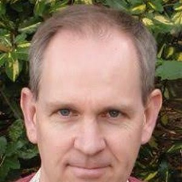

<!--
HOW TO EDIT THIS PAGE
Each person is one <div class="person">…</div> block. Copy one to add someone.
- Photo: put a square image (ideally 300×300) in assets/people/ and point the  at it.
  No photo yet? Replace the  with initials, e.g. <div class="avatar">AB</div>.
- Link: the href="…" on the name. Links open in a new tab.
- Role: optional <div class="role">…</div> line under the name.
-->

```{=html}
<section class="inst">
  <h2>University of Oxford</h2>
  <div class="people-grid">
    <div class="person"><a class="avatar" href="https://www.physics.ox.ac.uk/our-people/weisheimer" target="_blank" rel="noopener" tabindex="-1" aria-hidden="true"></a><div class="name"><a href="https://www.physics.ox.ac.uk/our-people/weisheimer" target="_blank" rel="noopener">Dr Antje Weisheimer</a></div><div class="role">Project Lead</div></div>
    <div class="person"><a class="avatar" href="https://sites.google.com/view/kristian-strommen/home" target="_blank" rel="noopener" tabindex="-1" aria-hidden="true"></a><div class="name"><a href="https://sites.google.com/view/kristian-strommen/home" target="_blank" rel="noopener">Dr Kristian Strommen</a></div></div>
    <div class="person"><a class="avatar" href="https://www.physics.ox.ac.uk/our-people/woollings" target="_blank" rel="noopener" tabindex="-1" aria-hidden="true"></a><div class="name"><a href="https://www.physics.ox.ac.uk/our-people/woollings" target="_blank" rel="noopener">Prof Tim Woollings</a></div></div>
    <div class="person"><a class="avatar" href="https://www.physics.ox.ac.uk/our-people/osprey" target="_blank" rel="noopener" tabindex="-1" aria-hidden="true"></a><div class="name"><a href="https://www.physics.ox.ac.uk/our-people/osprey" target="_blank" rel="noopener">Dr Scott Osprey</a></div></div>
    <div class="person"><a class="avatar" href="https://ryosatoh.github.io/" target="_blank" rel="noopener" tabindex="-1" aria-hidden="true"></a><div class="name"><a href="https://ryosatoh.github.io/" target="_blank" rel="noopener">Dr Ryo Satoh</a></div></div>
  </div>
</section>

<section class="inst">
  <h2>University of Reading</h2>
  <div class="people-grid">
    <div class="person"><a class="avatar" href="https://www.choreilly.com/" target="_blank" rel="noopener" tabindex="-1" aria-hidden="true"></a><div class="name"><a href="https://www.choreilly.com/" target="_blank" rel="noopener">Dr Chris O&#x27;Reilly</a></div></div>
    <div class="person"><a class="avatar" href="https://www.personal.reading.ac.uk/~pb901687/home/" target="_blank" rel="noopener" tabindex="-1" aria-hidden="true"></a><div class="name"><a href="https://www.personal.reading.ac.uk/~pb901687/home/" target="_blank" rel="noopener">Prof Jon Robson</a></div></div>
    <div class="person"><a class="avatar" href="https://www.met.reading.ac.uk/~sj903980/Home.html" target="_blank" rel="noopener" tabindex="-1" aria-hidden="true"></a><div class="name"><a href="https://www.met.reading.ac.uk/~sj903980/Home.html" target="_blank" rel="noopener">Prof Ted Shepherd</a></div></div>
    <div class="person"><a class="avatar" href="https://research.reading.ac.uk/meteorology/people/jochen-broecker/" target="_blank" rel="noopener" tabindex="-1" aria-hidden="true"></a><div class="name"><a href="https://research.reading.ac.uk/meteorology/people/jochen-broecker/" target="_blank" rel="noopener">Dr Jochen Broecker</a></div></div>
    <div class="person"><a class="avatar" href="https://eviatarbach.com/" target="_blank" rel="noopener" tabindex="-1" aria-hidden="true"></a><div class="name"><a href="https://eviatarbach.com/" target="_blank" rel="noopener">Dr Eviatar Bach</a></div></div>
    <div class="person"><a class="avatar" href="https://research.reading.ac.uk/meteorology/people/rowan-sutton/" target="_blank" rel="noopener" tabindex="-1" aria-hidden="true"></a><div class="name"><a href="https://research.reading.ac.uk/meteorology/people/rowan-sutton/" target="_blank" rel="noopener">Prof Rowan Sutton</a></div></div>
  </div>
</section>

<section class="inst">
  <h2>UK Met Office</h2>
  <div class="people-grid">
    <div class="person"><a class="avatar" href="https://www.metoffice.gov.uk/research/people/nick-dunstone" target="_blank" rel="noopener" tabindex="-1" aria-hidden="true"></a><div class="name"><a href="https://www.metoffice.gov.uk/research/people/nick-dunstone" target="_blank" rel="noopener">Dr Nick Dunstone</a></div></div>
  </div>
</section>

<section class="inst">
  <h2>ECMWF</h2>
  <div class="people-grid">
    <div class="person"><a class="avatar" href="https://www.ecmwf.int/node/22476" target="_blank" rel="noopener" tabindex="-1" aria-hidden="true"></a><div class="name"><a href="https://www.ecmwf.int/node/22476" target="_blank" rel="noopener">Dr Chris Roberts</a></div></div>
  </div>
</section>

<section class="inst">
  <h2>NCAR</h2>
  <div class="people-grid">
    <div class="person"><a class="avatar" href="https://impacts.ucar.edu/en/persons/stephen-yeager/" target="_blank" rel="noopener" tabindex="-1" aria-hidden="true"></a><div class="name"><a href="https://impacts.ucar.edu/en/persons/stephen-yeager/" target="_blank" rel="noopener">Dr Steve Yeager</a></div></div>
    <div class="person"><a class="avatar" href="https://staff.cgd.ucar.edu/cdeser/" target="_blank" rel="noopener" tabindex="-1" aria-hidden="true"></a><div class="name"><a href="https://staff.cgd.ucar.edu/cdeser/" target="_blank" rel="noopener">Dr Clara Deser</a></div></div>
  </div>
</section>

```
